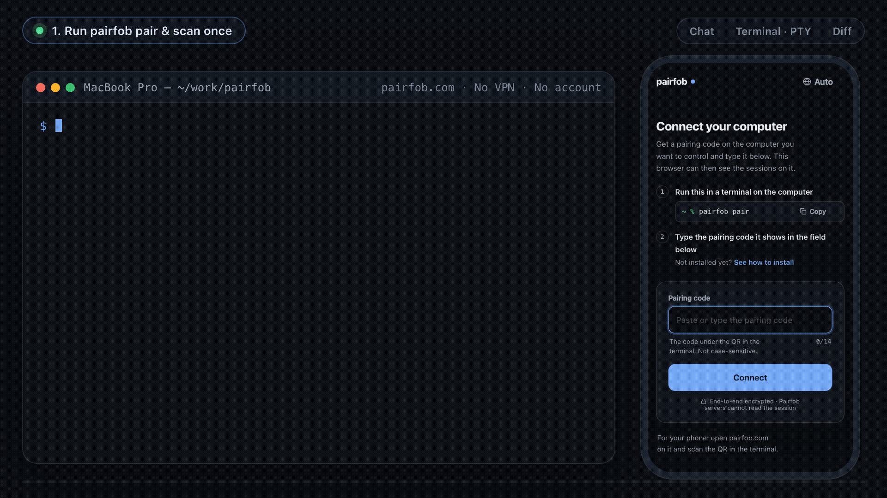
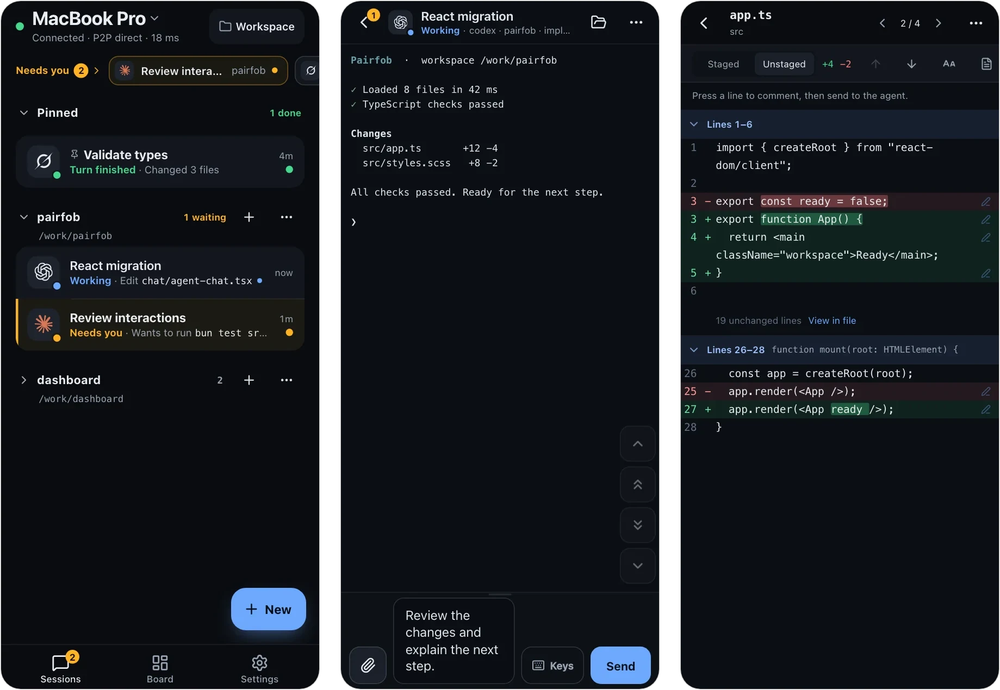

# Pairfob

[](LICENSE)
[](https://pairfob.com/demo)
[](https://pairfob.com)
[](https://pairfob.com/doc/)
[](https://github.com/arronKler/pairfob/discussions)

**English** | [简体中文](README_zh.md)

**Control Claude Code, Codex, Grok, and other local coding agents from your phone in one QR scan — no VPN, no open ports, no account required.** Your agents keep running on your computer; after pairing once, your phone, tablet, or another browser attaches to the same live sessions over an end-to-end encrypted WebRTC P2P connection (with an open-source, one-command self-hostable relay fallback).

👉 **[Try the interactive Live Demo in your browser](https://pairfob.com/demo)** — test Chat/Terminal switching, diff line comments, Board layout, and subscription quotas without installing anything.



## Why Pairfob?

| Capability | Pairfob | Official Remote Control (e.g. Claude Code) | SSH + Tailscale + tmux | Web / Cloud Agent Wrappers |
| --- | --- | --- | --- | --- |
| **Multi-agent support** | Claude Code, Codex, Grok, Gemini, Copilot, Cursor, OpenCode, Pi & plain shell | Single vendor only | Any CLI, raw terminal only | Usually 1–2 vendors |
| **True PTY + Chat dual mode** | Switch live between **Chat** (structured steps & markdown), **Control** (touch keypad), and **Terminal** (real PTY for vim/TUIs) | Chat-oriented UI | Raw PTY only (painful on phone) | Chat wrapper only (no real PTY) |
| **Diff review & line comments** | Browse workspace files, inspect git diffs, tap any line to send a review note straight to the agent | Basic / limited | CLI `git diff` only | Varies |
| **Board layout & multi-machine** | Visual multi-pane **Board**, Git worktrees, and instant switching across multiple computers | Single session focus | Manual tmux panes | Single host |
| **Subscription quota monitor** | Live allowance rings on your phone for Claude, Codex, Copilot, Cursor, Grok, Factory, Kiro, DeepSeek & more | No | No | No |
| **Network & privacy** | Outbound-only, **no VPN/Tailscale**, **no account**, SPAKE2+ / Argon2id E2EE, **WebRTC P2P direct**, 1-command self-hostable Cloudflare relay | Vendor account & vendor cloud | Requires VPN mesh + SSH keys on phone | Vendor account / server sees plaintext |

## Install and pair

Pairfob runs on macOS and Linux (Windows can open the browser client as a second screen). Your phone only needs a browser, and no Pairfob account is required. Keep the computer awake and online while using it.

1. **Install on the computer.** The installer verifies the binary, automatically sets up the underlying multi-session runtime ([Herdr](https://herdr.dev)) with zero manual config, and registers Pairfob as a login service.

   ```sh
   curl -fsSL https://pairfob.com/install.sh | sh
   ```

   If it reports the install directory is not on your `PATH`, run the one-line fix it prints. Flags, install paths, and uninstall: [Install](https://pairfob.com/doc/install).

2. **Pair your phone.** Run `pairfob pair` on your computer to display a QR code and fallback code:

   ```sh
   pairfob pair
   ```

   Open [pairfob.com/pair](https://pairfob.com/pair) on your phone, scan the QR code (or enter the code), then press **Enter** once on your computer to approve.

3. **Open or start a session.** Tap any running session in your phone's list, or choose **Create**, pick a project directory on your computer, and launch Claude Code, Codex, Grok, or **Terminal**.

Sessions are managed by the auto-installed session runtime ([Herdr](https://herdr.dev)): sessions started from your phone or inside `herdr` appear automatically. Pairfob uses the AI agents you already signed in to on your computer — **Terminal** works without any agent installed. Full walkthrough: [Get started](https://pairfob.com/doc/start).

Already using Herdr? `herdr plugin install arronKler/pairfob` adds **Pairfob: Pair a device** directly to Herdr's action menu. See [`plugin/herdr/`](plugin/herdr/README.md).

Versioned macOS and Linux binaries, SHA-256 checksums, and release notes are on [GitHub Releases](https://github.com/arronKler/pairfob/releases).

## What you can do on your phone



- **Never leave an agent waiting.** A **Needs you** strip and optional push notifications surface blocked or waiting agents; tap once to answer prompts or approve commands.
- **True PTY + Chat dual mode.** **Auto** picks **Control** (rendered terminal + system keyboard/dictation + touch keypad), **Terminal** (full PTY via xterm.js for vim and full-screen TUIs), or **Chat** (structured tool steps and Markdown replies).
- **Review diffs & attach files.** Browse workspace files, inspect git status and diffs, tap any diff line to write a review comment, and attach photos, PDFs, or files into your prompt.
- **Shape workspaces on the Board.** Create conversations, tabs, splits, and Git worktrees, and inspect a tab's live multi-pane layout on the **Board**.
- **Control multiple computers.** Switch between work and home machines from one phone — including remote machines reachable over SSH.
- **Track subscription quotas.** Monitor remaining allowance across Claude Code, Codex, Copilot, Cursor, Grok, DeepSeek, Factory, Kiro, OpenCode, and more, read locally on your computer.

The UI speaks English and 简体中文. Details: [Using the app](https://pairfob.com/doc/app).

## Mobile apps (optional)

Your phone works straight in Safari or Chrome (add to Home Screen for full-screen PWA mode). For a native shell with local notifications:

- **Android beta**: sideloaded APK for Android 7.0+ — [Android beta guide](https://pairfob.com/doc/android-beta) and [GitHub Releases](https://github.com/arronKler/pairfob/releases).
- **iOS**: native Capacitor shell with local notifications is in active preparation for TestFlight (`mobile/ios`).

## Security & self-hosting

- **Pairing** uses SPAKE2+ with terminal confirmation on your computer; session keys are hardened with Argon2id.
- **Zero-knowledge relay.** Keys stay exclusively on your computer and paired devices. The relay at `pairfob.com` only forwards opaque ciphertext frames.
- **WebRTC P2P direct.** Once authenticated, sessions upgrade to a direct WebRTC DataChannel and keep the relay only as encrypted fallback.
- **Zero inbound exposure.** The computer only makes outbound connections — no port forwarding, no VPN, no exposed local sockets.
- **One-command self-hosting.** Deploy the Worker, Durable Objects, D1 database, and web app to your own Cloudflare account in one command: [`docs/selfhost.md`](docs/selfhost.md).

See [What the relay cannot see](https://pairfob.com/doc/security) and report vulnerabilities privately via [SECURITY.md](SECURITY.md).

## Computer commands

```sh
pairfob          # status: service, paired devices, runtime
pairfob pair     # pair a phone, tablet or another computer
pairfob list     # paired devices
pairfob forget 1 # unpair by index or name
pairfob doctor   # diagnose this computer; changes nothing
pairfob update   # update to the latest release and restart
```

Add a second computer by running the same installer, then tapping **Settings → Switch computer → Add a computer** on your phone. Full CLI reference: [Computer commands](https://pairfob.com/doc/cli).

## How it works

```
phone  --HTTPS/WSS pairfob.v2-->  pairfob.com (Cloudflare Worker + Durable Object)
pairfob --outbound WSS---------->  same room  --opaque FWD-->  phone
          \-- WebRTC DataChannel after authenticated setup --/
pairfob --loopback-------------->  Herdr session runtime
```

Protocol specs live in [`proto/`](proto/), including [envelope](proto/envelope.md), [v2 mux](proto/envelope-v2.md), and [direct transport](proto/direct-transport.md).

| Path | What it is |
| --- | --- |
| `cmd/pairfob` | computer daemon and CLI (Go) |
| `internal/` | pairing, E2EE sessions, RPC, quota readers, journal adapters, runtime adapter |
| `pwa/` | responsive phone/tablet/desktop web app + `/demo` sandbox (React + TypeScript) |
| `workers/pairfob-origin` | relay origin: Cloudflare Worker + Durable Object |
| `site/` | homepage and [documentation](https://pairfob.com/doc/) sources |
| `proto/` | frozen envelope, RPC schema, and cross-language test vectors |
| `mobile/` | optional Android & iOS Capacitor shells |
| `desktop/` | native desktop client (Rust + GPUI) |
| `plugin/herdr` | Herdr plugin entrypoints |

## Develop

```sh
(cd pwa && bun install --frozen-lockfile)
./scripts/dev-up.sh     # local origin + pairfob + PWA on loopback
./scripts/verify.sh     # full gate: Go, PWA, Worker, site tests and builds
./scripts/dev-down.sh
```

Set `PAIRFOB_DEV_FAKE_RUNTIME=1` for demo data without Herdr. Real-phone testing, verification scope, protocol invariants, and releases: [`docs/develop.md`](docs/develop.md).

## Community & contributing

- **Questions, mobile gesture feedback, and new agent requests**: join [GitHub Discussions](https://github.com/arronKler/pairfob/discussions).
- **Want to contribute?** Check our [`good first issue`](https://github.com/arronKler/pairfob/labels/good%20first%20issue) list — adding a subscription quota adapter for your favorite agent CLI is a great self-contained first PR.

Run the checks matching your change (see [`docs/develop.md`](docs/develop.md#verification)) and list them in your PR. Protocol files under `proto/` are frozen by design; please open an issue before proposing changes there.

## Star History

<a href="https://www.star-history.com/?repos=arronkler%2Fpairfob&type=date&legend=top-left">
 <picture>
   <source media="(prefers-color-scheme: dark)" srcset="https://api.star-history.com/chart?repos=arronkler/pairfob&type=date&theme=dark&legend=top-left" />
   <source media="(prefers-color-scheme: light)" srcset="https://api.star-history.com/chart?repos=arronkler/pairfob&type=date&legend=top-left" />
   
 </picture>
</a>

## License

[Apache License 2.0](LICENSE). See [NOTICE](NOTICE).
