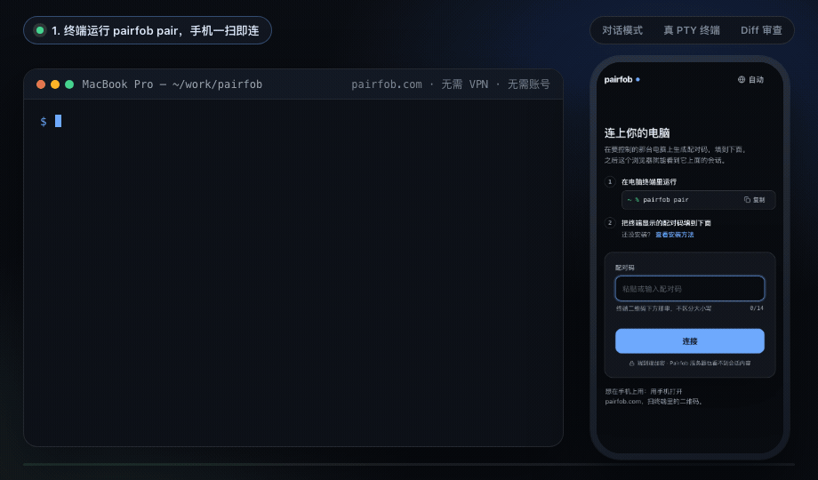
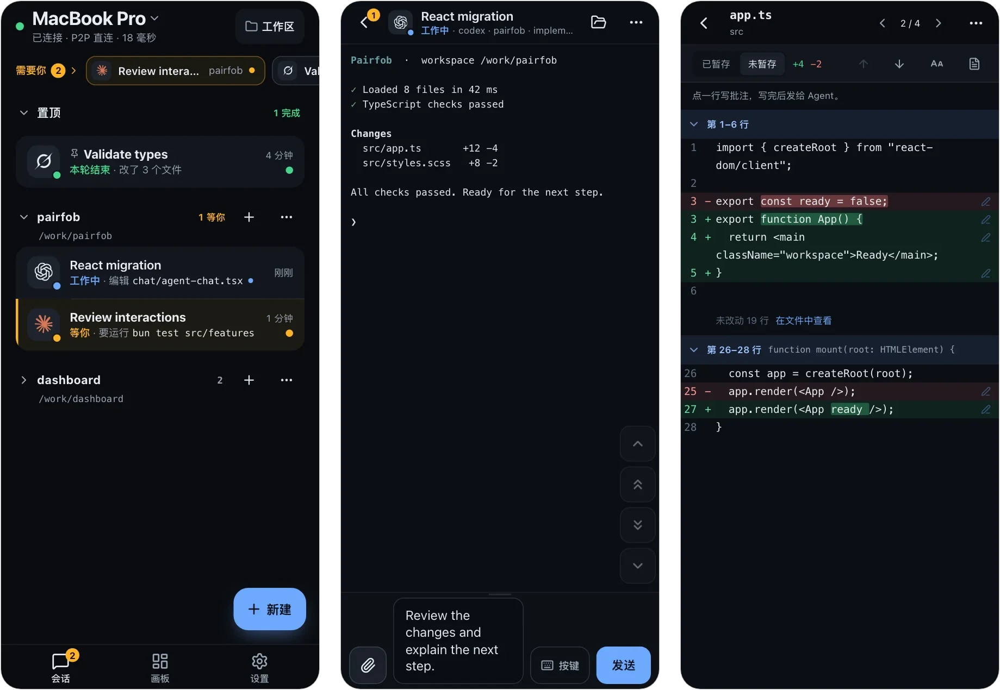

# Pairfob

[](LICENSE)
[](https://pairfob.com/demo?lang=zh)
[](https://pairfob.com/zh/)
[](https://pairfob.com/doc/zh/)
[](https://github.com/arronKler/pairfob/discussions)

[English](README.md) | **简体中文**

**用手机浏览器一扫，接管电脑上的 Claude Code、Codex、Grok 等本地编程 Agent——无需 VPN、无需开端口、无需注册账号。** Agent 继续留在你的电脑上运行；配对一次后，手机、平板或另一台电脑通过端到端加密的 WebRTC P2P 直连打开同一批活着的会话（支持一条命令自托管 Cloudflare 中继作为兜底）。

👉 **[免安装在线试玩（Live Demo）](https://pairfob.com/demo?lang=zh)** — 直接在浏览器里体验 Chat / 真终端切换、Diff 行级评论、画板布局和订阅额度监控。



## 核心差异对比

| 能力维度 | Pairfob | 官方 Remote Control（如 Claude Code） | SSH + Tailscale + tmux | 云端 / 网页套壳工具 |
| --- | --- | --- | --- | --- |
| **多 Agent 支持** | Claude Code、Codex、Grok、Gemini、Copilot、Cursor、OpenCode、Pi 及普通终端 | 仅限单一厂商 | 任意 CLI，但仅裸终端 | 通常仅 1–2 家 |
| **真 PTY + Chat 双模** | 一键切换 **对话**（结构化步骤与 Markdown）、**控制**（触控键区）与 **真终端**（完整 PTY，支持 vim/TUI） | 偏聊天交互 | 仅裸 PTY（手机操作门槛高） | 仅聊天封装，无真 PTY |
| **Diff 审查与行级评论** | 浏览工作区文件、看 git diff，点任意代码行直接写批注发回 Agent | 基础 / 有限 | 仅命令行 `git diff` | 参差不齐 |
| **画板布局与多机切换** | 可视化多窗格 **画板**、Git worktree、一台手机切换多台电脑 | 偏单会话 | 手动管理 tmux 分屏 | 通常单机 |
| **多平台订阅额度监控** | 手机一眼查看 Claude、Codex、Copilot、Cursor、Grok、Factory、Kiro、DeepSeek 等额度 | 无 | 无 | 无 |
| **网络与隐私** | 仅出站连接、**无需 VPN/Tailscale**、**无需账号**、SPAKE2+ / Argon2id 端到端加密、**WebRTC 直连**、支持一键自托管 Cloudflare 中继 | 需厂商账号并经厂商云 | 需组网工具 + 手机配 SSH 密钥 | 需注册账号 / 服务端可见明文 |

## 安装与配对

Pairfob 宿主支持 macOS 和 Linux（Windows 可用浏览器作为第二块屏幕打开）。手机只需浏览器，无需 Pairfob 账号。使用时让电脑保持唤醒并联网即可。

1. **在电脑上安装。** 安装脚本会校验二进制、自动配好底层多会话运行时（[Herdr](https://herdr.dev)，零手动配置），并把 Pairfob 注册为登录后自动启动的用户服务。

   ```sh
   curl -fsSL https://pairfob.com/install.sh | sh
   ```

   如果提示安装目录不在 `PATH` 上，按它打印的一行命令补上即可。安装参数、安装位置和卸载见[安装](https://pairfob.com/doc/zh/install)。

2. **配对手机。** 在电脑终端运行 `pairfob pair`，终端会打印二维码和手输配对码：

   ```sh
   pairfob pair
   ```

   在手机浏览器打开 [pairfob.com/pair](https://pairfob.com/pair)，扫码（或手输配对码），然后回电脑按一次 **Enter** 确认即可。

3. **打开或新建会话。** 在手机列表里点一个会话即可接管；点击 **创建**、选择电脑上的项目目录，即可直接启动 Claude Code、Codex、Grok 或 **终端**。

底层会话由安装脚本自动配好的运行时（[Herdr](https://herdr.dev)）托管：从手机或 `herdr` 里启动的会话会自动出现在列表中。Pairfob 直接使用你电脑上已登录的 AI Agent；**终端** 无需安装任何 Agent 也能直接用。完整步骤见[开始使用](https://pairfob.com/doc/zh/start)。

如果本来就在用 Herdr，运行 `herdr plugin install arronKler/pairfob` 即可把 **Pairfob: Pair a device** 加进动作菜单。见 [`plugin/herdr/`](plugin/herdr/README.md)。

各版本 macOS / Linux 二进制、SHA-256 校验文件与更新说明见 [GitHub Releases](https://github.com/arronKler/pairfob/releases)。

## 在手机上能做什么



- **Agent 等你时及时响应。** 列表顶部的 **需要你** 一栏与可选推送通知会立刻提示等待中的 Agent，点一下直达审批或回复。
- **真 PTY + 对话双模切换。** **自动** 会按会话选择 **控制**（终端画面 + 系统键盘听写 + 触控快捷键区）、**终端**（基于 xterm.js 的真实 PTY，适合 vim 和全屏 TUI）或 **对话**（结构化工具步骤与 Markdown 回复）。
- **审查 Diff、传递文件。** 浏览工作区文件、查看 git 状态和 diff，点任意 diff 行写批注发给 Agent，也可以上传照片、PDF 或其他文件插入草稿。
- **在画板上管理工作区。** 新建对话、标签页、分屏和 Git worktree，在 **画板** 上直观查看并调整标签页的真实多窗格布局。
- **多台电脑、多台设备。** 一台手机在公司和家里的电脑之间自由切换，也支持直接纳管通过 SSH 连接的远端机器。
- **看多平台订阅余量。** 由电脑本地读取 Claude Code、Codex、Copilot、Cursor、Grok、DeepSeek、Factory、Kiro、OpenCode 等账号的实时剩余额度。

界面支持简体中文和 English。详见[界面怎么用](https://pairfob.com/doc/zh/app)。

## 移动端 App（可选）

手机在 Safari 或 Chrome 里直接打开就能用（添加到主屏幕即全屏 PWA 体验）。如果你更习惯原生壳与本地通知：

- **Android 测试版**：支持 Android 7.0+ 的侧载 APK — 见[Android 测试版](https://pairfob.com/doc/zh/android-beta)与 [GitHub Releases](https://github.com/arronKler/pairfob/releases)。
- **iOS**：带本地通知的原生 Capacitor 壳正在筹备 TestFlight（源码见 `mobile/ios`）。

## 安全与一键自托管

- **配对安全**：使用 SPAKE2+ 并必须在电脑终端按 Enter 确认，会话密钥经 Argon2id 加固。
- **零知识中继**：密钥只保存在你的电脑与已配对设备上。`pairfob.com` 中继只转发无法解密的密文帧。
- **WebRTC P2P 直连**：会话建立后自动升级为点对点 WebRTC DataChannel，中继仅作为加密兜底。
- **零公网暴露**：电脑只主动往外连，无需端口映射、无需 Tailscale/VPN，本地端口绝不暴露。
- **一条命令自托管**：将 Worker、Durable Objects、D1 和 Web 应用一键部署到你自己的 Cloudflare 账号：[`docs/selfhost.md`](docs/selfhost.md)。

详见[中继看不到什么](https://pairfob.com/doc/zh/security)。安全漏洞请按 [SECURITY.md](SECURITY.md) 私下报告。

## 电脑上的命令

```sh
pairfob          # 状态：服务、已配对设备、运行时
pairfob pair     # 配对手机、平板或另一台电脑
pairfob list     # 已配对设备
pairfob forget 1 # 按序号或名字解除配对
pairfob doctor   # 检查这台电脑；不做任何修改
pairfob update   # 更新到最新版本并重启服务
```

第二台电脑运行同一个安装脚本，然后在手机上用 **设置 → 切换电脑 → 添加电脑** 配对即可。完整命令见[电脑上的命令](https://pairfob.com/doc/zh/cli)。

## 工作原理

```
phone  --HTTPS/WSS pairfob.v2-->  pairfob.com (Cloudflare Worker + Durable Object)
pairfob --outbound WSS---------->  same room  --opaque FWD-->  phone
          \-- WebRTC DataChannel after authenticated setup --/
pairfob --loopback-------------->  Herdr 会话运行时
```

协议规格位于 [`proto/`](proto/)，包括[信封格式](proto/envelope.md)、[v2 复用协议](proto/envelope-v2.md)和[直连传输](proto/direct-transport.md)。

| 目录 | 内容 |
| --- | --- |
| `cmd/pairfob` | 电脑端 daemon 和命令行（Go） |
| `internal/` | 配对、端到端加密会话、RPC、额度读取器、Agent 日志与运行时适配 |
| `pwa/` | 手机 / 平板 / 桌面自适应 Web 应用与 `/demo` 在线试玩（React + TypeScript） |
| `workers/pairfob-origin` | 中继服务：Cloudflare Worker + Durable Object |
| `site/` | 主页和[文档](https://pairfob.com/doc/zh/)源码 |
| `proto/` | 冻结的信封格式、RPC schema 和跨语言测试向量 |
| `mobile/` | 可选的 Android & iOS Capacitor 原生壳 |
| `desktop/` | 原生桌面客户端（Rust + GPUI） |
| `plugin/herdr` | Herdr 插件入口 |

## 开发

```sh
(cd pwa && bun install --frozen-lockfile)
./scripts/dev-up.sh     # 在本机回环地址启动 origin + pairfob + PWA
./scripts/verify.sh     # 完整检查：Go、PWA、Worker、站点测试和构建
./scripts/dev-down.sh
```

设置 `PAIRFOB_DEV_FAKE_RUNTIME=1` 可不接 Herdr、直接使用模拟数据运行。真机调试、验证范围、协议约束和发布流程见 [`docs/develop.md`](docs/develop.md)（英文）。

## 社区与参与贡献

- **使用交流、移动端手势/键盘痛点、新 Agent 适配需求**：欢迎前往 [GitHub Discussions](https://github.com/arronKler/pairfob/discussions)。
- **想提第一个 PR？** 查看 [`good first issue`](https://github.com/arronKler/pairfob/labels/good%20first%20issue) 列表——为你常用的编程 Agent CLI 补一个订阅额度读取器是非常清晰的独立任务。

按改动范围运行对应检查（见 [`docs/develop.md`](docs/develop.md#verification)），并在 PR 中写明跑了哪些检查。`proto/` 下的信封格式、测试向量和 RPC 字段是有意冻结的，想改动请先开 issue 讨论。

## Star 历史

<a href="https://www.star-history.com/?repos=arronkler%2Fpairfob&type=date&legend=top-left">
 <picture>
   <source media="(prefers-color-scheme: dark)" srcset="https://api.star-history.com/chart?repos=arronkler/pairfob&type=date&theme=dark&legend=top-left" />
   <source media="(prefers-color-scheme: light)" srcset="https://api.star-history.com/chart?repos=arronkler/pairfob&type=date&legend=top-left" />
   
 </picture>
</a>

## 许可证

[Apache License 2.0](LICENSE)。见 [NOTICE](NOTICE)。
